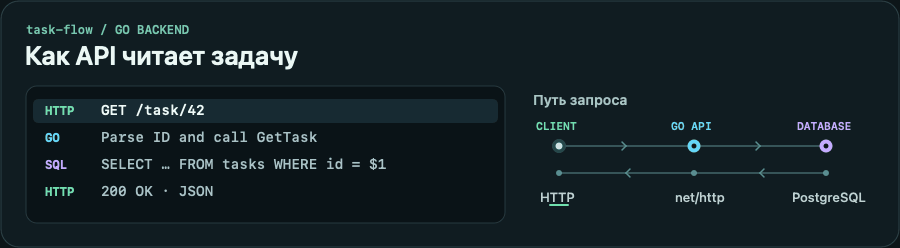

<h1 align="center">mikail-tommard</h1>

<strong>Go-бэкенд · Инструменты для разработчиков · Локальный ИИ</strong>

  
  
  
  
  
  
  

  Пишу HTTP-сервисы на Go и делаю инструменты для работы с Codex. 
  В моих проектах есть локальные MCP-серверы, автоматизация рабочего стола и API с PostgreSQL.

  

## Инструменты для Codex

<table>
  <tr>
    <td width="50%" valign="top">
      <h3><a href="https://github.com/mikail-tommard/ai-workspace">Forma · AI Workspace</a></h3>
      
Локальное рабочее пространство, где Codex может выводить задачи, графики, изображения и документы на интерактивную панель. Go-сервер обслуживает панель и хранит данные в SQLite.

      Go · SQLite · MCP
    </td>
    <td width="50%" valign="top">
      <h3><a href="https://github.com/mikail-tommard/codex-vision">Codex Vision</a></h3>
      
Локальный MCP-сервер для работы с приложениями через интерфейс. Агент может делать снимки экрана, находить окна и выполнять разрешённые действия мышью и клавиатурой.

      Go · MCP · Accessibility · системные API
    </td>
  </tr>
</table>

## Бэкенд и системные проекты

| Проект | Что внутри |
| --- | --- |
| [task-flow](https://github.com/mikail-tommard/task-flow) | Учебный сервис задач с HTTP API. PostgreSQL хранит данные, RabbitMQ используется для асинхронных уведомлений. |
| [sabr](https://github.com/mikail-tommard/sabr) | Full-stack MVP на Vue и Go. В бэкенде реализованы регистрация, вход и обновление токенов с хранением данных в PostgreSQL. |
| [ecom](https://github.com/mikail-tommard/ecom) | Бэкенд интернет-магазина с регистрацией, авторизацией и миграциями PostgreSQL для товаров и заказов. |
| [link-checker](https://github.com/mikail-tommard/2025-12-10-links) | Go-сервис, который принимает список ссылок, проверяет их доступность и формирует PDF-отчёт. |
| [decimal](https://github.com/mikail-tommard/decimal) | Реализация десятичной арифметики на C. |

## Технические заметки

В [notes](https://github.com/mikail-tommard/notes) собираю примеры и конспекты по Go, Git, Docker, SQL и Nginx.
